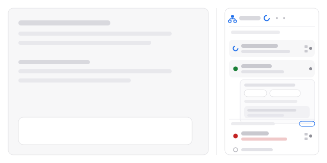

# dsh-subagent-panel

A subagent panel for the **DeepSeek Harness** right sidebar. It shows the subagent tree of the conversation you are looking at, keeps it live as session events arrive, and lets you drill into any single subagent without leaving the conversation.



## Features

- **One card per subagent**, each showing the **latest three lines** of that subagent's conversation, live: every card retains its own child session and subscribes to its event stream, so new messages slide in without a refresh.
- **Live tree** of the current conversation's subagents — direct children, plus grandchildren you expand. Token usage and active duration update as the session publishes.
- **Four colour-coded states.** Running (animated accent arc), completed (green), ended abnormally (red), not running (hollow grey). "Ended abnormally" is derived from the last turn's end reason, so it honestly covers aborts and token-limit stops as well as hard errors.
- **Detail drawer per card.** Creation time, usage figures, and a longer preview with a "jump to latest" pill. While the child is running the preview follows the newest message, and pauses following the moment you scroll up.
- **Clear cards.** The trash control at the end of a card clears just that card; the header can clear every finished card at once; a hidden-count bar restores them. Clearing hides cards **in this panel only**, is remembered per conversation, and never deletes a session.
- **Stop a running subagent** through the Harness interrupt API.
- **Keyboard accessible** via tree semantics (`role="tree"` / `treeitem`), arrow-key roving focus, `Enter`/`Space` to open the detail, and a proper focus ring. Motion is suppressed under `prefers-reduced-motion`.
- **Chinese and English** UI, following the app locale.

## Install

### From npm

```bash
dsh plugin install dsh-subagent-panel
```

Or through the Harness UI: **Settings → Plugins → Install**, and enter `dsh-subagent-panel`.

### From a local checkout

Point the plugin manager at this directory; it is a linked local bundle, so edits take effect after a page reload:

```bash
dsh plugin install /absolute/path/to/dsh-subagent-panel
```

## Opening the panel

There are three entry points, all inside the conversation:

1. **Automatic.** When the right sidebar is expanded, holds no tabs for the current conversation, and that conversation already has subagents, the panel is placed there silently — no focus stealing, no replacing whatever you were viewing.
2. **Keyboard.** `Ctrl+Shift+S`. The command is registered in the shortcut catalog, so you can rebind it under **Settings → Shortcuts**.
3. **Guide card.** Right sidebar → `+` → **Subagents**.

Closing the panel is remembered per conversation: it will not reappear automatically. Open it manually to bring it back.

## How it works

This is a DeepSeek Harness **bundle**: `package.json` declares `dsh.bundle.patch` and `dsh.client`, the patch inserts the plugin into the loader, and the client half renders into the right sidebar.

| Concern | Mechanism |
| --- | --- |
| Tab type | `ctx.sidebarRightTabs.register` with kind `subagentpanel`, a guide card, and a `Ctrl+Shift+S` shortcut |
| Tab body | `sidebar.right.pane.tab`, keyed by the package id |
| Address | `dsh-resource://subagentpanel/session/<rootId>` for an explicitly addressed tab, `sidebar://subagentpanel` for the page tab, which falls back to the tab's own session scope |
| Data | `useSessions` / `useSessionStatus` projections — `subagentCatalog`, `subagentTiming`, `tokenUsage` |
| Transcript | `ctx.sessions.retain(address)` on the child session's event stream, released on unmount |
| Stop | `ctx.get('remote.subagents').interruptByUser(sessionId)` |

It reads only session data the client already holds and makes **no model requests of its own**.

## Requirements

- A DeepSeek Harness build that ships the right sidebar (`sidebar.right.pane.tab`) and the shortcuts service. Developed and tested against a recent desktop build.
- No dependencies, no build step: `client.js` is plain browser JavaScript using `React.createElement`.

## Known limitations

- Every visible card retains its child session so it can show live lines. With dozens of subagents in one conversation that is dozens of live subscriptions; collapse branches you do not care about, or clear the cards you no longer need.
- Clearing is view-level: the session log and the subagent sessions themselves are untouched.
- The per-card icon buttons are not in the Tab order; the keyboard path is `Enter` on the card, then the drawer's buttons.
- The cleared-card set is stored in `localStorage` per conversation and is never evicted.
- On unload the plugin closes only the tabs of conversations this window has adopted.

## 中文说明

**子智能体面板**是 DeepSeek Harness 右侧栏的插件：**每个子智能体是一张卡片**，卡片底部实时显示该子代理**最近三行**对话——每张卡片各自 retain 其子会话并订阅事件流，新消息无需刷新就会滑入。状态四色区分（运行中／已完成／未正常结束／未运行），用量与耗时随会话事件自动更新。

点卡片展开详情：创建时间、用量、更长的对话预览。运行中的子智能体会**自动跟随最新消息**滚动，你手动上滚则暂停并出现「跳到最新」。

有三种打开方式：侧栏为空且当前对话已有子智能体时**自动放入**；按 **Ctrl+Shift+S**；或侧栏「+」里的「子智能体」卡片。关掉之后按对话记住，不会再自动出现。

行尾垃圾桶可单独清除一张卡片，头部可一键清除已结束的，也能全部恢复——**清除只影响本面板显示，不删除任何会话**。运行中的子智能体可以停止。

安装：

```bash
dsh plugin install dsh-subagent-panel
```

## License

[MIT](LICENSE)
